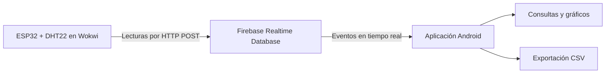

# Consulta Ambiental

Aplicación Android para consultar y analizar datos ambientales almacenados en Firebase Realtime Database. Integra lecturas de un ESP32 con sensor DHT22 simulado en Wokwi y permite explorar temperatura, humedad relativa y punto de rocío mediante consultas temporales, gráficos y exportación de resultados.

Proyecto académico del curso IC-3101. La aplicación móvil constituye el componente de este repositorio desarrollado para el portafolio.

## Funcionalidades

- **Lectura actual:** temperatura, humedad, punto de rocío y fecha del último registro, con actualización en tiempo real.
- **Promedios por hora:** consulta de un día y selección de cualquiera de sus 24 franjas horarias.
- **Promedios por día:** análisis de un rango de fechas, con cantidad de lecturas y gráfico de barras.
- **Extremos históricos:** mínimos y máximos por variable, fechas de registro y repeticiones.
- **Filtro de valores atípicos:** límites mínimo y máximo editables por variable, aplicados a los cálculos, gráficos y exportaciones.
- **Exportación CSV:** resultados con unidades, fechas, zona horaria y límites del filtro cuando está activo.
- **Apariencia:** navegación inferior, tarjetas de medición y temas claro y oscuro con preferencia guardada.

## Flujo de datos



El firmware envía una lectura por minuto y solicita a Firebase la fecha del servidor. La app escucha los cambios y realiza los cálculos de consulta a partir de los registros recibidos.

El punto de rocío se calcula en el ESP32 mediante la aproximación de Magnus, usando temperatura y humedad relativa.

## Tecnologías

| Componente | Tecnologías |
| --- | --- |
| Aplicación móvil | Kotlin, Jetpack Compose, Material 3 |
| Datos | Firebase Realtime Database |
| Dispositivo simulado | ESP32, DHT22, C++ y Wokwi |
| Compilación | Gradle con Kotlin DSL y catálogo de versiones |
| Pruebas | JUnit para cálculos, filtros, escalas y formato CSV |

## Estructura

```text
APP-MOVIL/
├── android/       Aplicación Android y pruebas
└── wokwi/         Firmware y circuito simulado
WEB/               Espacio del componente web
```

- [Configuración y ejecución de la app](APP-MOVIL/README.md)
- [Comportamiento de las consultas y comprobaciones](APP-MOVIL/android/CONSULTAS.md)
- [Estado del componente web](WEB/README.md)

## Ejecutar el proyecto

```bash
git clone https://github.com/greivinsmv/Consulta-de-variables-ambientales.git
```

Abre `APP-MOVIL/android` en Android Studio, configura el SDK y Firebase según la [guía de la aplicación móvil](APP-MOVIL/README.md), sincroniza Gradle y ejecuta el módulo `app` en un dispositivo con Android 8.0 o superior.

La simulación está disponible en [Wokwi](https://wokwi.com/projects/477474234161260545). Al modificar los valores del DHT22 y ejecutar la simulación, las nuevas lecturas se reflejan en la app conectada al mismo proyecto Firebase.

## Criterios de análisis

Las fechas de consulta se interpretan en `America/Costa_Rica`. Cada promedio utiliza las lecturas numéricas válidas de la variable seleccionada; los periodos vacíos se muestran como **Sin datos**. El filtro excluye valores de los resultados sin modificar el historial de Firebase.

Los gráficos y CSV comparten los mismos cálculos que los resultados en pantalla. Las pruebas unitarias cubren promedios, extremos, límites del filtro, datos ausentes y exportación.

## Estado y alcance

La aplicación Android, la integración con Firebase y el envío desde Wokwi están implementados y se han probado con lecturas simuladas. El componente web está pendiente de implementación y corresponde a otro integrante del equipo. La validación con un historial sintético de 10 días sigue pendiente.

La configuración de conexión pertenece a un entorno de demostración. Para una instalación propia, adapta el proyecto Firebase, sus permisos de acceso y la validación TLS del firmware; los detalles están en la guía móvil.
