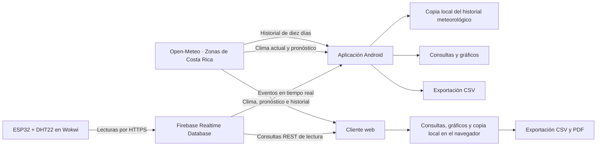

# Consulta Ambiental

Aplicación Android y cliente web para consultar y analizar datos ambientales procedentes de Firebase Realtime Database y de Open-Meteo. Integra lecturas de un ESP32 con sensor DHT22 simulado en Wokwi y permite explorar temperatura, humedad relativa y punto de rocío mediante consultas temporales, gráficos y exportación de resultados.

Proyecto académico del curso IC-3101. El repositorio reúne la aplicación móvil, el cliente web y la configuración de acceso a los datos.

## Funcionalidades

- **Clima de Costa Rica:** condiciones actuales, pronóstico por hora y de diez días para diez zonas, con actualización automática cada 15 minutos mientras Inicio está visible.
- **Historial meteorológico:** datos horarios de los diez días completos anteriores para la zona seleccionada, con una copia local independiente por lugar para consultar sin conexión.
- **Lectura actual:** temperatura, humedad, punto de rocío y fecha del último registro; Android escucha cambios en tiempo real y la web consulta cada 30 segundos mientras Inicio está visible.
- **Promedios por hora:** consulta de un día y selección de cualquiera de sus 24 franjas horarias.
- **Promedios por día:** gráfica de un rango de fechas y resumen del día elegido, sin una lista de tarjetas por fecha.
- **Comparación de variables:** temperatura, humedad y punto de rocío en la misma gráfica, con escalas separadas para °C y %.
- **Extremos históricos:** mínimos y máximos por variable, fechas de registro y repeticiones.
- **Filtro de valores atípicos:** límites mínimo y máximo editables por variable, aplicados a los cálculos, gráficos y exportaciones.
- **Exportación CSV:** resultados con unidades, fechas, zona horaria y límites del filtro cuando está activo.
- **Informes PDF en la web:** gráfica, estadísticas y detalle del periodo consultado.
- **Apariencia:** navegación inferior, tarjetas de medición y temas claro y oscuro con preferencia guardada.
- **Información:** apartado accesible desde la cabecera con fuentes, créditos, licencia y criterios de análisis.

## Flujo de datos



El firmware envía una lectura por minuto y solicita a Firebase la fecha del servidor. Ambos clientes leen esos registros y calculan sus consultas sin credenciales de escritura.

El punto de rocío se calcula en el ESP32 mediante la aproximación de Magnus, usando temperatura y humedad relativa.

## Tecnologías

| Componente | Tecnologías |
| --- | --- |
| Aplicación móvil | Kotlin, Jetpack Compose, Material 3 |
| Cliente web | HTML, CSS, JavaScript, Chart.js y jsPDF |
| Datos | Firebase Realtime Database y API REST de Open-Meteo |
| Dispositivo simulado | ESP32, DHT22, C++ y Wokwi |
| Compilación | Gradle con Kotlin DSL y catálogo de versiones |
| Pruebas | JUnit en Android; comprobaciones de JavaScript y Playwright en la web |

## Estructura

```text
APP-MOVIL/
└── android/       Aplicación Android y pruebas
firebase/          Reglas de acceso, pruebas y configuración del dispositivo
WEB/               Cliente web, servidor de desarrollo y pruebas
```

- [Configuración y ejecución de la app](APP-MOVIL/README.md)
- [Comportamiento de las consultas y comprobaciones](APP-MOVIL/android/CONSULTAS.md)
- [Configuración y pruebas del cliente web](WEB/README.md)
- [Acceso de lectura y autenticación del ESP32](firebase/README.md)

## Ejecutar el proyecto

```bash
git clone https://github.com/greivinsmv/Consulta-de-variables-ambientales.git
```

Abre `APP-MOVIL/android` en Android Studio, configura el SDK y Firebase según la [guía de la aplicación móvil](APP-MOVIL/README.md), sincroniza Gradle y ejecuta el módulo `app` en un dispositivo con Android 8.0 o superior.

Para la web, con Python 3 y desde la carpeta del repositorio:

```sh
python WEB/servidor-dev.py
```

Abre `http://localhost:8000`. La [guía web](WEB/README.md) describe las dependencias de red y cómo ejecutar las pruebas.

La simulación de Wokwi se mantiene aparte del repositorio. El dispositivo utiliza una cuenta exclusiva de Firebase Authentication; la app recibe sus nuevas lecturas sin credenciales de escritura. Consulta la [configuración de acceso](firebase/README.md) para preparar y publicar las reglas.

## Clima y pronósticos

Selecciona **Clima de Costa Rica** como fuente y elige una zona con **Cambiar** en Android o con el selector **Zona** en la web. Hay diez lugares disponibles: Santa Clara, San José, Alajuela, Cartago, Heredia, Liberia, Puntarenas, Limón, La Fortuna y San Isidro de Pérez Zeledón. La selección se conserva entre sesiones.

Inicio muestra la condición actual, temperatura, humedad y punto de rocío, las próximas 24 horas y un pronóstico de diez días. Las filas diarias presentan probabilidad de lluvia y temperaturas mínima y máxima. El fondo y los iconos se dibujan localmente; las condiciones se obtienen de los códigos WMO de la API.

**Cargar historial** descarga los diez días completos anteriores para la zona seleccionada, en horario de Costa Rica. La copia se guarda en el teléfono o en el navegador y alimenta las consultas por hora, por día y de extremos. En la web, las consultas por hora y por día también descargan el periodo elegido cuando falta en la copia guardada. El pronóstico futuro se mantiene separado de ese historial.

Los valores son estimaciones de un modelo meteorológico, no mediciones de una estación local. **Información (ⓘ)** reúne los detalles y créditos; los CSV incluyen la zona y la atribución. Datos de [Open-Meteo](https://open-meteo.com/) bajo [CC BY 4.0](https://creativecommons.org/licenses/by/4.0/).

## Criterios de análisis

Las fechas de consulta se interpretan en `America/Costa_Rica`. Cada promedio utiliza las lecturas numéricas válidas de la variable seleccionada; los periodos vacíos se muestran como **Sin datos**. El filtro excluye valores de los resultados sin modificar el historial de Firebase.

Los gráficos y CSV comparten los mismos cálculos que los resultados en pantalla. Las pruebas unitarias cubren promedios, extremos, límites del filtro, datos ausentes y exportación.

## Estado y alcance

La aplicación Android y el cliente web están implementados. Ambos consultan lecturas simuladas del ESP32, pronósticos y datos históricos de Open-Meteo. Las pruebas verifican los cálculos, filtros, exportaciones y casos de error por separado de la apariencia. La web cuenta con 58 comprobaciones del núcleo y 16 regresiones de interfaz automatizadas en Chromium; las gráficas y los informes también se han comprobado con las bibliotecas reales.

La configuración de conexión pertenece a un entorno de demostración. Esta rama incluye reglas y pruebas para limitar la escritura al dispositivo; deben configurarse con su UID y publicarse en Firebase para surtir efecto. La configuración de cliente Firebase y las coordenadas de Open-Meteo son públicas. Las contraseñas, tokens y claves administrativas quedan fuera del repositorio.
