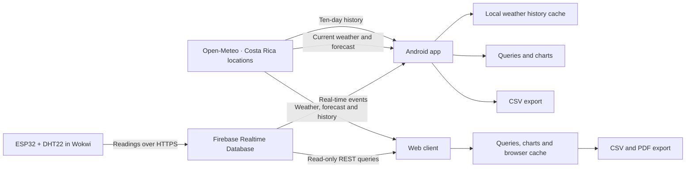

# Consulta Ambiental

**English** | [Español](README.es.md)

An Android app and web client for exploring environmental data from Firebase Realtime Database and Open-Meteo. The project combines simulated ESP32/DHT22 readings with weather data for Costa Rica, with time-based queries, charts, configurable filters and exports for temperature, relative humidity and dew point.

Academic team project for the IC-3101 course. This repository contains the mobile app, web client and database access configuration.

## Features

- **Weather in Costa Rica:** current conditions, hourly forecasts and a ten-day forecast for ten locations, refreshed every 15 minutes while the Home screen is visible.
- **Weather history:** hourly data for the previous ten complete days, with a separate local copy for each location that can be analyzed offline.
- **Latest reading:** temperature, humidity, dew point and timestamp. Android listens for updates in real time; the web client polls every 30 seconds while Home is visible.
- **Hourly averages:** query a day and select any of its 24 hourly intervals.
- **Daily averages:** compare a date range in a chart and inspect an individual day.
- **Variable comparison:** plot temperature, humidity and dew point together, with separate scales for °C and %.
- **Historical extremes:** minimum and maximum values, timestamps and repeated occurrences.
- **Outlier filtering:** editable limits for each variable, applied consistently to calculations, charts and exports.
- **CSV export:** results with units, dates, time zone and active filter limits.
- **Web PDF reports:** chart, statistics and details of the selected period.
- **Light and dark themes:** saved appearance preferences and measurement cards.
- **Information panel:** data sources, attribution, licenses and calculation criteria in one place.

The interface uses Spanish labels. The setup instructions below keep those labels so they match the application.

## Data flow



The firmware sends one reading per minute and requests a Firebase server timestamp. Both clients read the records and calculate their results without write credentials. The ESP32 calculates dew point from temperature and relative humidity using the Magnus approximation.

## Technology

| Component | Technologies |
| --- | --- |
| Mobile app | Kotlin, Jetpack Compose, Material 3 |
| Web client | HTML, CSS, JavaScript, Chart.js, jsPDF |
| Data | Firebase Realtime Database and Open-Meteo REST API |
| Simulated device | ESP32, DHT22, C++, Wokwi |
| Build | Gradle with Kotlin DSL and a version catalog |
| Tests | JUnit for Android; JavaScript checks and Playwright for the web |

## Repository structure

```text
APP-MOVIL/
└── android/       Android app and tests
firebase/          Access rules, tests and device authentication tools
WEB/               Web client, development server and tests
```

- [Android setup and usage](APP-MOVIL/README.md)
- [Query calculations and verification scenarios (Spanish)](APP-MOVIL/android/CONSULTAS.md)
- [Web setup and tests](WEB/README.md)
- [Database access and ESP32 authentication](firebase/README.md)
- [Security review and public configuration (Spanish)](SEGURIDAD.md)

## Getting started

```sh
git clone https://github.com/greivinsmv/Consulta-de-variables-ambientales.git
cd Consulta-de-variables-ambientales
```

For Android, open `APP-MOVIL/android` in Android Studio, configure the SDK and Firebase using the [mobile guide](APP-MOVIL/README.md), sync Gradle and run the `app` module on Android 8.0 or later.

For the web client, install Python 3 and run from the repository root:

```sh
python WEB/servidor-dev.py
```

Open `http://localhost:8000`. The [web guide](WEB/README.md) covers network dependencies and tests.

The Wokwi simulation is maintained separately. The device uses a dedicated Firebase Authentication account; the clients receive its readings without write credentials. Follow the [access guide](firebase/README.md) to configure and deploy the rules.

## Weather and forecasts

Select **Clima de Costa Rica** as the data source, then choose a location using **Cambiar** on Android or the **Zona** selector on the web. The ten locations are Santa Clara, San José, Alajuela, Cartago, Heredia, Liberia, Puntarenas, Limón, La Fortuna and San Isidro de Pérez Zeledón. The selection is saved between sessions.

Home shows current conditions, temperature, humidity, dew point, the next 24 hours and a ten-day forecast. Daily rows show rain probability and minimum/maximum temperatures. Backgrounds and icons are drawn locally; weather conditions come from the API's WMO codes.

**Cargar historial** downloads the previous ten complete days for the selected location in Costa Rica time. The phone or browser stores a local copy for hourly, daily and extreme-value analysis. On the web, hourly and daily queries also fetch the selected period when it is missing from the cache. Future forecasts are kept separate from historical data.

These values are weather model estimates rather than measurements from a local station. **Información (ⓘ)** contains the details and credits; CSV files include the location and attribution. Data from [Open-Meteo](https://open-meteo.com/) under [CC BY 4.0](https://creativecommons.org/licenses/by/4.0/).

## Calculation rules

Dates use `America/Costa_Rica`. Each average uses the selected variable's valid numeric readings; empty periods display **Sin datos** (no data). Filtering excludes values from the results without modifying Firebase records.

Charts, CSV files and on-screen results use the same calculations. Unit tests cover averages, extremes, filter boundaries, missing data and exports.

## Status and scope

The Android app and web client support simulated ESP32 readings and Open-Meteo forecasts and history. Tests cover calculations, filters, exports and error handling separately from visual checks. The web suite includes 58 core checks and 17 interface regressions in Chromium; charts and reports have also been checked with the real libraries.

The included connection settings belong to a demonstration project. The repository provides rules and tests that restrict writes to the device; configure the device UID and deploy those rules to your Firebase project. Firebase client configuration and weather coordinates are public. Passwords, session tokens and administrative keys stay outside the repository.
